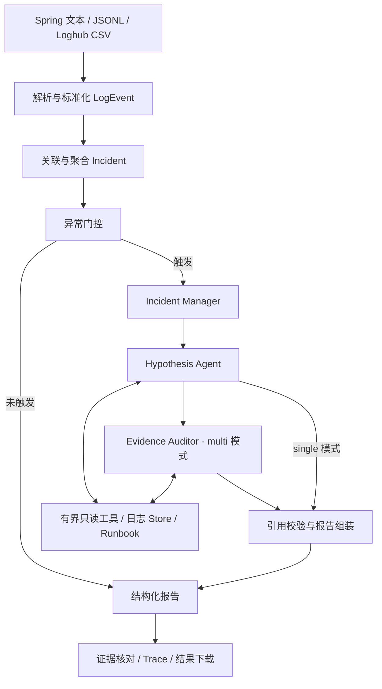

# LogRCA · Spring 日志辅助排查工具

[](https://github.com/icybinbin/logrca-spring-agent/actions/workflows/tests.yml)

LogRCA 是一个基于 Agent 工具调用的本地日志分析工具。导入 Spring 日志后，系统按请求链路或时间窗口聚合事件，检索异常上下文，生成根因假设、证据引用和排查建议。每条引用都可以回查源文件的行号与 Java 堆栈，并导出诊断报告及执行记录。

支持 **DeepSeek 模型诊断**和**离线规则基线**，提供 Streamlit 网页与命令行两种入口。

## 功能

- **多格式日志接入**：常见 Spring Boot 文本、Java 多行堆栈、ECS/Logstash JSONL 和 Loghub structured CSV。
- **事故聚合与异常筛选**：优先按 trace/request ID 关联，缺失关联 ID 时使用时间窗口；门控未触发时直接返回报告。
- **工具调用诊断**：模型通过有界只读工具检索日志、查询时间线、回查证据与读取 Runbook。
- **独立证据审核**：多 Agent 模式增加 Evidence Auditor，核验候选引用，筛除无法支持根因的症状日志。
- **可核对的结果**：报告保留证据 ID、原文件行号、堆栈、备选假设和下一步排查项。
- **运行记录与导出**：保存模型请求、工具调用、Token 用量、耗时及失败状态，支持下载结果 ZIP。

## 快速开始

使用 Python 3.11 或 3.12。克隆仓库，或从 [Releases](https://github.com/icybinbin/logrca-spring-agent/releases/latest) 下载独立项目包。

在项目目录打开 PowerShell：

```powershell
python -m venv .venv
.\.venv\Scripts\python.exe -m pip install -r requirements.txt
.\.venv\Scripts\python.exe -X utf8 run_web.py
```

Linux/macOS：

```bash
python3 -m venv .venv
.venv/bin/python -m pip install -r requirements.txt
.venv/bin/python run_web.py
```

浏览器打开 [http://127.0.0.1:8501](http://127.0.0.1:8501)。选择内置样例或上传日志，点击“开始诊断”，在“核对日志证据”中查看引用对应的原文，然后下载结果。

完整操作说明见 [QUICKSTART](QUICKSTART.md)。

## DeepSeek 配置

默认模型为 `deepseek-flash`，使用 Python 标准库 `urllib` 调用 DeepSeek API。启动前，在同一 PowerShell 窗口设置密钥：

```powershell
$deepseekKey = Read-Host '请输入 DeepSeek API Key' -AsSecureString
$env:DEEPSEEK_API_KEY = [System.Net.NetworkCredential]::new('', $deepseekKey).Password
.\.venv\Scripts\python.exe -X utf8 run_web.py
```

在网页选择“DeepSeek”后开始诊断。也可以使用命令行分析文件：

```powershell
.\.venv\Scripts\python.exe -X utf8 -m logrca analyze --path data\spring_db_pool.log --backend deepseek --model deepseek-flash --mode multi --max-incidents 1 --output-dir outputs\deepseek_spring
```

模型通过 [Tool Calls](https://api-docs.deepseek.com/zh-cn/guides/tool_calls/) 选择查询工具，最终结果采用 JSON 输出并由 Pydantic 校验。密钥从进程环境变量读取；项目不自动加载 `.env` 文件。

| 模式 | 决策方式 | 适用场景 |
|---|---|---|
| `offline`（默认） | 本地规则与语义签名 | 无密钥运行、功能回归、可复现的基线评测 |
| `deepseek` | 模型选择工具、生成假设并审核证据 | 对支持格式的日志进行模型辅助排查 |

`single` 模式运行根因专家，`multi` 模式增加独立证据审核。默认每个事故最多 12 次模型请求、单次网络超时 30 秒；CLI 默认分析 1 个事故，范围可通过 `--max-incidents` 调整。模型调用失败会保留错误和 Trace。

## 命令行

以下命令在已安装依赖的 Python 环境中执行：

```powershell
# 分析 Spring 文本日志
python -X utf8 -m logrca analyze --path data\spring_db_pool.log --mode multi --output-dir outputs\spring

# 分析 ECS/Logstash JSONL
python -X utf8 -m logrca analyze --path data\spring_db_pool.jsonl --output-dir outputs\jsonl

# 分析公开 HikariCP 日志节选
python -X utf8 -m logrca analyze --path data\public_hikari_1546_excerpt.log --output-dir outputs\public_hikari

# 单 Agent / 多 Agent 离线对照
python -X utf8 -m logrca benchmark --mode both
```

## 架构



解析、关联、工具执行、预算与引用校验由 Python 管理；模型负责查询选择、根因假设和证据支持关系判断。最终证据须属于当前事故，并通过候选与审核结果的交集过滤。缺少合格的直接证据时，结果保留为 `unknown`。

| 模块 | 职责 |
|---|---|
| `spring_parser.py` / `spring_json_parser.py` / `normalizer.py` | 日志解析与统一事件模型 |
| `correlation.py` / `detector.py` | 事故聚合与异常门控 |
| `store.py` | 日志查询、时间线、证据回查与 Runbook |
| `runtime.py` | Agent 循环、工具注册、状态与 Trace |
| `deepseek_adapter.py` | DeepSeek 请求、工具协议、调用预算与模型编排 |
| `agents.py` / `openai_adapter.py` | 离线策略、可选 SDK 适配与证据报告组装 |
| `pipeline.py` / `file_app.py` | 文件分析管线、证据定位与结果导出 |
| `benchmarking.py` / `p0_runner.py` | 标签隔离评测与单/多 Agent 对照 |

详细说明见 [系统架构](docs/ARCHITECTURE.md)。

## 输出

| 产物 | 内容 |
|---|---|
| `reports/` | 根因假设、证据引用、影响服务、备选原因、建议与限制 |
| `traces/` | 模型请求、工具调用、工具结果、审核和最终引用校验 |
| `run-*.json` | 模型名称、请求状态、Token 用量、耗时及输出路径 |
| 网页下载 ZIP | 报告、`run-summary.json`、`source-evidence.json` 和 Trace |

网页证据视图展示基础脱敏后的内容与物理行号。上传原文件在临时目录分析后删除；本机输出保存在 `outputs/web/`。下载包包含证据摘录，不包含上传原文件。

## 日志样例

| 文件 | 内容 | 来源 |
|---|---|---|
| `data/spring_db_pool.log` | 连接获取超时及后续调用失败，含 Java 堆栈 | 构造案例 |
| `data/spring_db_pool.jsonl` | 相同类型事故的 ECS/Logstash JSONL | 构造案例 |
| `data/spring_agent_cases.log` | 连接池、Redis、网关症状、未知异常与正常请求 | 构造案例 |
| `data/public_hikari_1546_excerpt.log` | Spring/Hikari 调用栈与连接获取超时 | [HikariCP Issue #1546](https://github.com/brettwooldridge/HikariCP/issues/1546) 节选 |

公开日志节选未确认最终原因。来源、摘录位置和处理记录见 [PUBLIC_SAMPLES](docs/PUBLIC_SAMPLES.md)；外部数据归属见 [DATA_SOURCES](docs/DATA_SOURCES.md)。

## 测试与评测

```powershell
# 核心测试
python -X utf8 -m pytest -m "not loghub"

# 构建独立项目 ZIP
python -X utf8 scripts\package_project.py
```

GitHub Actions 在 Python 3.11、3.12 上执行核心测试。外部 Loghub 集成测试需要另行下载数据并设置 `LOGHUB_ROOT`。

离线 P0 基准包含 120 个标签侧车案例，其中 test split 为 40 个案例，覆盖 8 类已知故障、正常、未知故障及证据删除等扰动。固定 seed `20260921` 的离线策略结果：

| 指标 | Single | Multi |
|---|---:|---:|
| Incident Detection F1 | 1.0000 | 1.0000 |
| RCA Top-1 | 0.8125 | 0.8125 |
| Evidence micro Precision | 0.4103 | 0.9275 |
| Evidence micro Recall | 1.0000 | 1.0000 |
| 平均工具调用次数 | 3.600 | 5.400 |

以上指标来自开发者合成分布下的确定性离线策略。Multi 在该基准中提高证据精确率，并增加工具调用；真实模型效果需单独评测。指标定义与标签隔离方式见 [EVALUATION](docs/EVALUATION.md)。

## 使用范围

- 网页上传支持 UTF-8 文件，单文件不超过 5MB；支持的布局与字段见 [QUICKSTART](QUICKSTART.md)。
- 缺失 trace ID 时使用 60 秒时间窗聚合；文本缺失时区时采用 UTC 假设并标记。
- 工具只读，输出排查建议；实际处置由使用者执行。
- 连接获取超时等日志可支持故障假设，更深原因可能需要指标、链路或变更记录补充。
- 输出置信度是未校准的评分。模型诊断涉及付费 API 调用；日志发送前应确认数据使用范围，基础脱敏不覆盖所有敏感字段。

## 文档

- [安装与操作](QUICKSTART.md)
- [系统架构](docs/ARCHITECTURE.md)
- [数据与评测](docs/EVALUATION.md)
- [公开日志样例](docs/PUBLIC_SAMPLES.md)
- [数据来源](docs/DATA_SOURCES.md)
